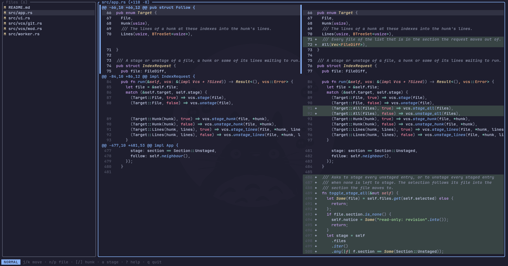

# dunk

A terminal tool for reviewing git changes before you commit them. It shows a file list and a diff side by side, and lets you stage or unstage whole files, hunks or single lines as you read.



## Requirements

- git, on your `PATH`. dunk runs it for every diff and every stage or unstage.
- Rust 1.85 or newer, to build. The crate uses the 2024 edition.
- A terminal with ANSI color. Truecolor is only needed if you set `#rrggbb` colors.

## Installation

Clone the repository and install the binary into `~/.cargo/bin`:

```sh
git clone <repository-url> dunk
cd dunk
cargo install --path .
```

If you have [just](https://github.com/casey/just) installed, `just release` runs the same command. Make sure `~/.cargo/bin` is on your `PATH`.

## Usage

Run `dunk` inside a git repository.

```sh
dunk                        # staged, unstaged and untracked changes
dunk --staged               # only staged changes
dunk --unstaged             # only unstaged changes
dunk HEAD~3                 # a revision, read-only
dunk main..feature          # a range, read-only
dunk main feature           # two revisions, read-only
dunk -- src/ '*.rs'         # limit the diff to these pathspecs
dunk -C ../other-repo       # run as if started in another directory
```

With no revision, the file list has two sections, unstaged and staged. A file with both kinds of change appears in both, and each entry shows only its own section's diff. With a revision or range the diff is read-only, so the staging keys only show a "read-only: revision" notice.

### Options

| Flag | Effect |
| --- | --- |
| `--staged` | Show only staged changes. Conflicts with a revision. |
| `--unstaged` | Show only unstaged changes. Conflicts with a revision. |
| `--layout unified\|split` | One column, or old and new side by side. |
| `--border plain\|rounded` | Corner style of the pane borders. |
| `--theme NAME` | Syntax highlighting theme. An unknown name is an error. |
| `-U, --context N` | Unchanged lines around each change. |
| `-w, --watch` | Refresh when files change. |
| `--no-watch` | Do not refresh, even if the config file asks for it. |
| `--syntax` | Turn syntax highlighting on, even if the config file turns it off. |
| `--no-syntax` | Turn syntax highlighting off. |
| `--config PATH` | Read this config file instead of the default one. |
| `-C, --directory PATH` | Run as if started in this directory. |
| `-V, --version` | Print the version. |

### Keys

Press `?` in dunk for the same list.

| Key | Action |
| --- | --- |
| `j` / `k`, arrows | Move the cursor down, up |
| `Space` / `PgDn`, `PgUp` | Page down, up |
| `Ctrl-d` / `Ctrl-u` | Half page down, up |
| `g` / `G`, `Home` / `End` | Jump to the top, bottom |
| `h` / `l`, `←` / `→` | Pan the code left, right by 8 columns. The line numbers, markers and hunk headers stay put. |
| `]` / `[` | Next, previous hunk |
| `n` / `p`, `}` / `{`, `Tab` / `Shift-Tab` | Next, previous file |
| `,` / `.` | First, last file |
| `s` | Switch between split and unified layout |
| `+` / `-` | Show 3 more or 3 fewer unchanged lines around the hunk under the cursor |
| `=` | Return to the default context |
| `v` | Enter visual mode to select lines. `Esc` or `v` leaves it. |
| `a` | Stage or unstage the hunk under the cursor, or the selection in visual mode |
| `f` | Stage or unstage the whole file |
| `A` | Stage every unstaged file, or unstage every staged file when none is left to stage |
| `e` | Open the cursor's line in `$VISUAL` or `$EDITOR` |
| `?` | Open the help menu |
| `q`, `Esc`, `Ctrl-c` | Quit |

The footer shows the current mode, normal or visual.

### Editor

`e` runs `$VISUAL`, or `$EDITOR` when `$VISUAL` is unset or blank. Terminal editors get `+LINE path`, which works with vim, neovim, nano, helix and most others. VS Code builds (`code`, `code-insiders`, `codium`) get `--goto path:LINE` and open their own window. A removed line has no line in the file, so dunk opens the next line in the hunk that has one.

## Configuration

dunk reads `$XDG_CONFIG_HOME/dunk/config.toml`, or `~/.config/dunk/config.toml` when `XDG_CONFIG_HOME` is unset. A missing default file is fine. A missing file named with `--config` is an error, as is any unknown key or invalid value.

A flag on the command line overrides the config file for that run. Every key is optional.

```toml
[ui]
border = "rounded"      # "plain" (default) or "rounded"

[diff]
layout = "split"        # "unified" (default) or "split"
context = 5             # git's default of 3 when unset

[syntax]
enabled = true
theme = "nord"          # case-insensitive

[watch]
enabled = false
```

### Highlight groups

The `[highlights]` table restyles parts of the screen. Group names are CamelCase, after Neovim's. A group you leave out keeps its ANSI default.

| Group | Part of the screen |
| --- | --- |
| `Normal` | Base text and background |
| `Border` | Pane borders and the help title |
| `DiffBorder` | Added to `Border` on the diff pane only |
| `CursorLine` | The row under the cursor |
| `SectionLabel` | The unstaged and staged labels in the file list |
| `ModeNormal`, `ModeVisual` | The mode label in the footer |
| `DiffAdd`, `DiffDelete` | Added and removed lines |
| `DiffAddText`, `DiffDeleteText` | Changed words inside an added or removed line |
| `DiffHunkHeader` | The row that opens a hunk |
| `DiffCurrentHunk` | Added to `DiffHunkHeader` on the hunk under the cursor |
| `DiffHunkBar` | The bar beside an unstaged hunk, white by default |
| `DiffHunkBarStaged` | The bar beside a staged hunk or a hunk in a revision, blue by default |
| `DiffHunkSeparator` | The rule between two hunks, dark gray by default |
| `Visual` | Selected lines in visual mode |

Each group takes `fg`, `bg`, `bold`, `italic`, `underline` and `reverse`. A color is an ANSI name such as `"bright-red"`, a palette index such as `42`, or `"#rrggbb"`.

```toml
[highlights]
DiffAdd = { bg = "#12261e" }
DiffDelete = { bg = "#2d1618" }
Visual = { reverse = true }
```

### Example: Catppuccin Mocha

A complete config file with the Catppuccin Mocha syntax theme and matching highlight groups.

```toml
[syntax]
enabled = true
theme = "Catppuccin Mocha"

[highlights]
Normal = { fg = "#cdd6f4", bg = "#1e1e2e" }
Border = { fg = "#585b70" }
DiffBorder = { fg = "#89b4fa" }
CursorLine = { bg = "#313244" }
SectionLabel = { fg = "#cba6f7", bold = true }
ModeNormal = { fg = "#1e1e2e", bg = "#89b4fa", bold = true }
ModeVisual = { fg = "#1e1e2e", bg = "#cba6f7", bold = true }
DiffHunkBar = { fg = "#cdd6f4" }
DiffHunkBarStaged = { fg = "#89b4fa" }

DiffAdd = { bg = "#394545" }
DiffDelete = { bg = "#493446" }
DiffAddText = { bg = "#546d5c" }
DiffDeleteText = { bg = "#734a5f" }
DiffHunkHeader = { fg = "#89b4fa" }
DiffCurrentHunk = { bg = "#313244", bold = true }
Visual = { bg = "#585b70" }
```

## Terms

CONTEXT.md defines the words this README uses, such as changeset, scope and hunk header.